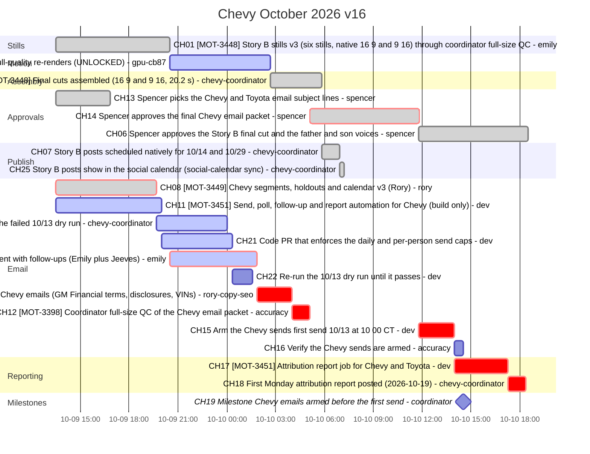

# Gantt

Generated from `plan.yaml` by `python -m planner gantt`. Do not edit by hand.

- Plan: chevy-october-2026 v16
- Origin: 2026-10-09T13:30:00-05:00
- CPM duration: 28.0417h (std dev 4.3702h along the critical path)
- Resource-constrained makespan: 29h
- Critical path: CH08, CH09, CH10, CH12, CH14, CH15, CH17, CH18
- `crit` means unconstrained CPM slack is zero. Bar times are the resource-constrained schedule.

| ID | Start | Finish | Slack | Assignee | Critical |
| --- | --- | --- | --- | --- | --- |
| CH01 | 0 | 7 | 5 | emily | no |
| CH08 | 0 | 6.1667 | 0 | rory | yes |
| CH11 | 0 | 6.5 | 14.9583 | dev | no |
| CH13 | 0 | 3.35 | 11.4 | spencer | no |
| CH20 | 6.1667 | 10.5 | 9.7083 | chevy-coordinator | no |
| CH21 | 6.5 | 10.8333 | 15.875 | dev | no |
| CH02 | 7 | 13.1667 | 5 | gpu-cb87 | no |
| CH09 | 7 | 12.3333 | 0 | emily | yes |
| CH22 | 10.8333 | 12.0833 | 9.7083 | dev | no |
| CH10 | 12.3333 | 14.5 | 0 | rory-copy-seo | yes |
| CH04 | 13.1667 | 16.3333 | 5 | chevy-coordinator | no |
| CH12 | 14.5 | 15.5833 | 0 | accuracy | yes |
| CH14 | 15.5833 | 22.2917 | 0 | spencer | yes |
| CH07 | 16.3333 | 17.4167 | 10.3583 | chevy-coordinator | no |
| CH25 | 17.4167 | 17.6833 | 10.3583 | chevy-coordinator | no |
| CH06 | 22.2917 | 29 | 5 | spencer | no |
| CH15 | 22.2917 | 24.4583 | 0 | dev | yes |
| CH16 | 24.4583 | 25 | 3.875 | accuracy | no |
| CH17 | 24.4583 | 27.7917 | 0 | dev | yes |
| CH19 | 25 | 25 | 3.875 | coordinator | no |
| CH18 | 27.7917 | 28.875 | 0 | chevy-coordinator | yes |

