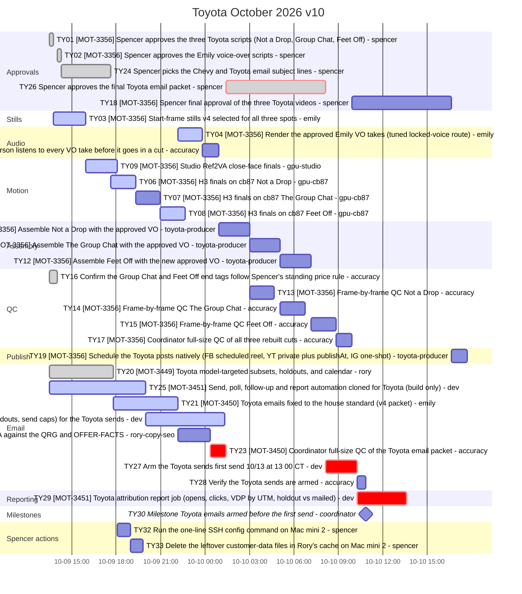

# Gantt

Generated from `plan.yaml` by `python -m planner gantt`. Do not edit by hand.

- Plan: toyota-october-2026 v10
- Origin: 2026-10-09T13:30:00-05:00
- CPM duration: 24.125h (std dev 4.0528h along the critical path)
- Resource-constrained makespan: 28.2083h
- Critical path: TY23, TY26, TY27, TY29
- `crit` means unconstrained CPM slack is zero. Bar times are the resource-constrained schedule.

| ID | Start | Finish | Slack | Assignee | Critical |
| --- | --- | --- | --- | --- | --- |
| TY01 | 0 | 0.2667 | 6.9 | spencer | no |
| TY16 | 0 | 0.5417 | 10.9583 | accuracy | no |
| TY20 | 0 | 4.3333 | 0 | rory | no |
| TY25 | 0 | 6.5 | 12.125 | dev | no |
| TY03 | 0.2667 | 2.4333 | 6.9 | emily | no |
| TY02 | 0.5417 | 0.8083 | 8.4833 | spencer | no |
| TY24 | 0.8083 | 4.1583 | 8.5667 | spencer | no |
| TY09 | 2.4333 | 4.6 | 6.9 | gpu-studio | no |
| TY06 | 4.1583 | 5.825 | 7.4 | gpu-cb87 | no |
| TY21 | 4.3333 | 8.6667 | 0 | emily | no |
| TY32 | 4.6 | 5.45 | 23.275 | spencer | no |
| TY33 | 5.45 | 6.3 | 23.275 | spencer | no |
| TY07 | 5.825 | 7.4917 | 7.4 | gpu-cb87 | no |
| TY31 | 6.5 | 11.8333 | 13.2917 | dev | no |
| TY08 | 7.4917 | 9.1583 | 7.4 | gpu-cb87 | no |
| TY04 | 8.6667 | 10.3333 | 8.4833 | emily | no |
| TY22 | 8.6667 | 10.8333 | 0 | rory-copy-seo | no |
| TY05 | 10.3333 | 11.4167 | 8.4833 | accuracy | no |
| TY23 | 10.8333 | 11.9167 | 0 | accuracy | yes |
| TY10 | 11.4167 | 13.5 | 6.9 | toyota-producer | no |
| TY26 | 11.9167 | 18.625 | 0 | spencer | yes |
| TY11 | 13.5 | 15.5833 | 6.9 | toyota-producer | no |
| TY13 | 13.5 | 15.1667 | 6.9 | accuracy | no |
| TY12 | 15.5833 | 17.6667 | 6.9 | toyota-producer | no |
| TY14 | 15.5833 | 17.25 | 6.9 | accuracy | no |
| TY15 | 17.6667 | 19.3333 | 6.9 | accuracy | no |
| TY27 | 18.625 | 20.7917 | 0 | dev | yes |
| TY17 | 19.3333 | 20.4167 | 6.9 | accuracy | no |
| TY18 | 20.4167 | 27.125 | 6.9 | spencer | no |
| TY28 | 20.7917 | 21.3333 | 2.7917 | accuracy | no |
| TY29 | 20.7917 | 24.125 | 0 | dev | yes |
| TY30 | 21.3333 | 21.3333 | 2.7917 | coordinator | no |
| TY19 | 27.125 | 28.2083 | 6.9 | toyota-producer | no |

